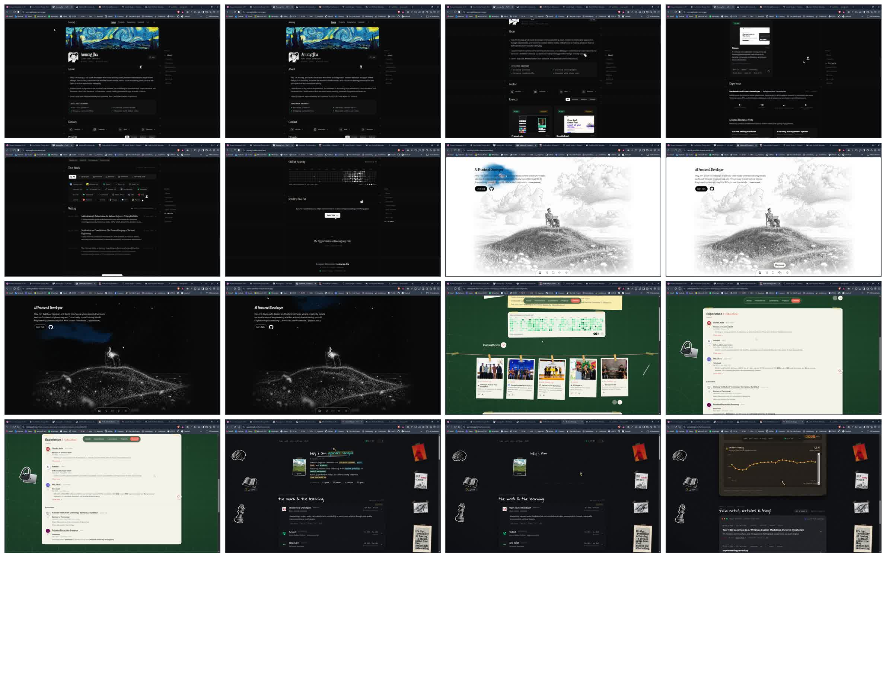
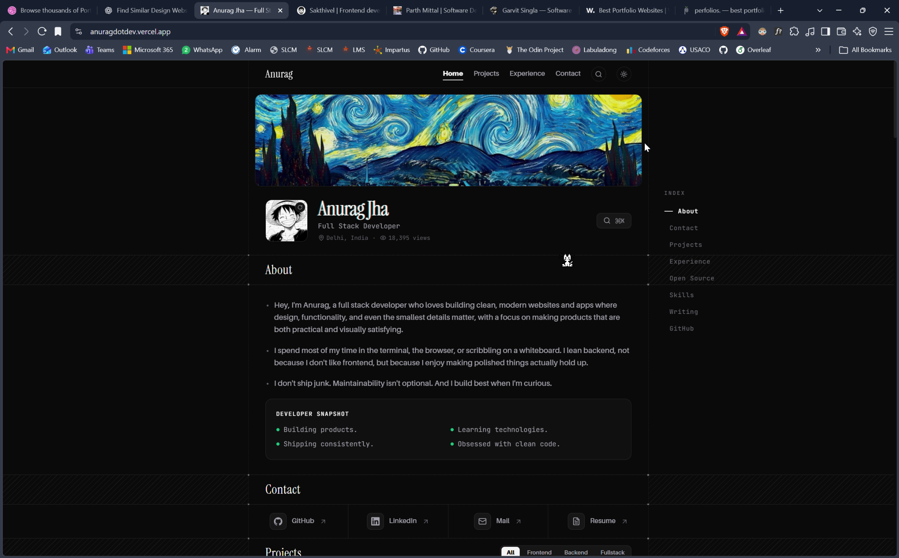
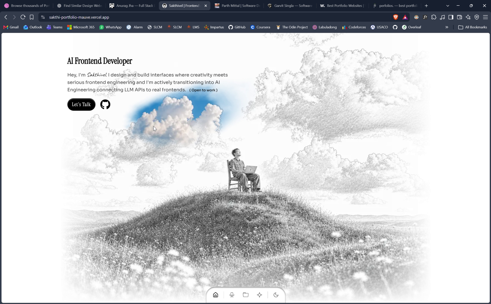
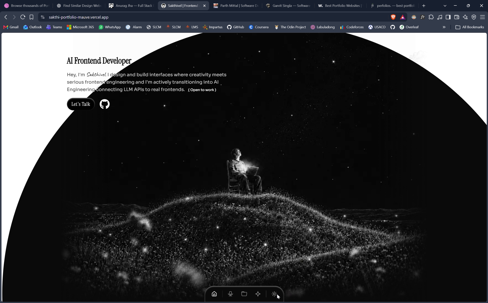
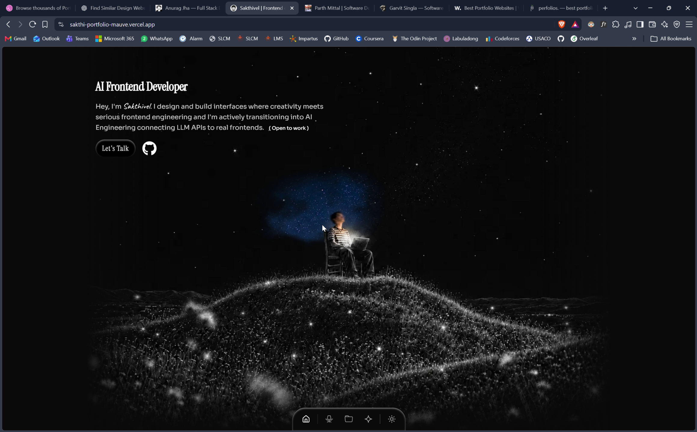
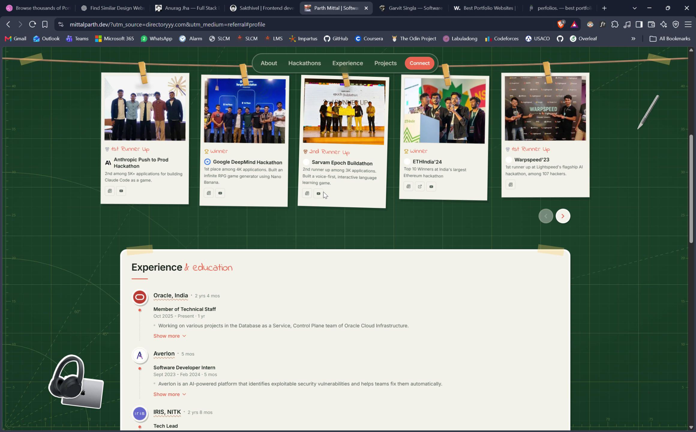
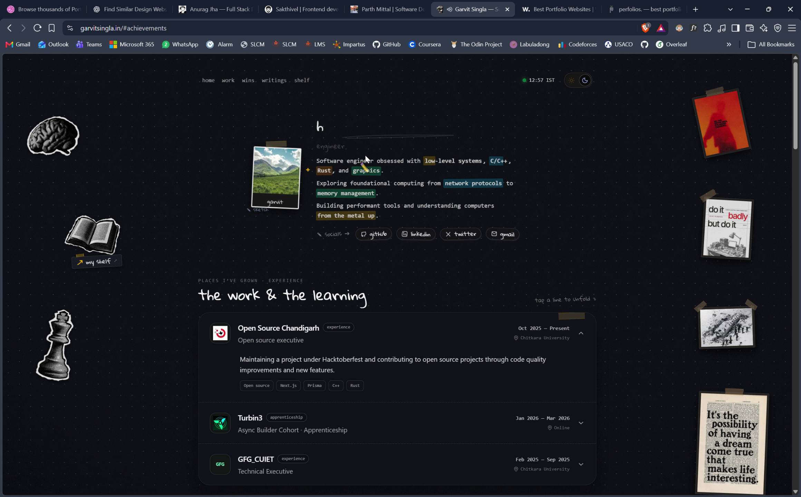

# Reference analysis

**Status:** CURRENT observations and TARGET adaptations. October 14, 2026.

## Owner-selected references, October 15

The owner explicitly reaffirmed this recording and these five links as the main references for future portfolio work.
Use the recording for visual structure, component behavior, smoothness and coherence. Keep the later request for larger, readable text and controls.

| Reference                                                        | Use in this portfolio                                                                                                             |
| ---------------------------------------------------------------- | --------------------------------------------------------------------------------------------------------------------------------- |
| Supplied Brave recording                                         | Compare composition, section rhythm, hover states and motion against the [timestamped analysis](video-component-analysis.md).     |
| [Anurag source](https://github.com/nodeanurag/my-portfolio)      | Main structure, section hierarchy, project presentation, command search and footer rhythm.                                        |
| [Sakthi source](https://github.com/sakthii05/portfolio)          | Atmospheric interaction and later paired-image reveal. Background work remains deferred until the owner supplies the four images. |
| [Garvit source](https://github.com/garvittsingla/portfolio)      | Activity panels, heatmap presentation, achievements and consistent card treatment.                                                |
| [Garvit achievements](https://www.garvitsingla.in/#achievements) | Specific visual reference for the achievement section and hanging event cards.                                                    |
| [Parth website](https://mittalparth.dev/)                        | Event wall, hackathon cards, photographs and event storytelling.                                                                  |

Recording path: `/mnt/c/Users/Debrato/Videos/Captures/Anurag Jha — Full Stack Developer - Brave 2026-10-14 12-56-53.mp4`.
The [capture receipt](references/video-component-audit/receipt.json) identifies the source file. Full-resolution stills remain under `docs/references/video-component-audit/`.
The [GitHub review](github-source-review.md) records inspected public revisions and source limits. Parth's current deployment source remains unverified.
Use these references together while retaining Debrato's own identity, content and larger readable scale.
This preference does not change the pending artwork, personal photographs or live-service boundaries.

## Live browser refresh, October 15

A later [component and motion review](component-motion-review.md) captures all four references again and compares them with the current foreground.
Its [new receipts](references/review-2026-10-15/capture-receipt.json) retain fresh source metadata and screenshots.
The review records smaller failure-state controls, an unavailable calendar keyboard defect at 320px, and misleading profile-error copy.
The audit itself did not change application code. The owner then approved the sketch-ledger refinement.
[Current implementation evidence](../design-qa.md) records the larger scale and corrected failure states.

All four references were loaded in Chromium. Desktop and mobile captures are stored under `docs/references/screenshots/`; [capture receipt](references/live-capture-receipt.json) records viewport, fonts, page errors and overflow checks.
The pages were scrolled before capture so lazy sections could load. These captures supplement the supplied recording; the selected mockups remain the primary visual targets.
Anurag exposes a labeled theme toggle. Garvit opens a dialog with Ctrl+K. No dialog opened for the same shortcut on the other three captured pages; this is a limited observation, not proof that no command interface exists.
All four mobile captures had no horizontal document overflow and no observed page errors. This is not an accessibility or performance qualification of those sites.
The older retrieval failures below are historical, not current access claims.

## Evidence and limits

The supplied recording lasts 49.052 seconds and has a 2320 × 1440 frame.
It records a desktop Brave window. It supplies no mobile, keyboard, screen-reader, reduced-motion, or device-performance evidence.
Timecodes below identify inspected frames, rather than exact tab-switch boundaries.

## Four observed references

| Reference and timecodes                                                   | Observed strengths                                                                                                                          | Adopt                                                                            | Reject or adapt                                                                                                      | Evidence limits                                                                                                                                                       |
| ------------------------------------------------------------------------- | ------------------------------------------------------------------------------------------------------------------------------------------- | -------------------------------------------------------------------------------- | -------------------------------------------------------------------------------------------------------------------- | --------------------------------------------------------------------------------------------------------------------------------------------------------------------- |
| [Anurag](https://anuragdotdev.vercel.app/), 00:06 and 00:15               | Narrow aligned reading column, persistent right index, ruled section bands, compact contacts, project categories, calendar legend and total | Content density, section navigation, clear metadata, source-profile links        | Do not copy the banner, avatar, wording, gray heatmap, cursor mascot, or dense technology-logo wall                  | Search and category controls are visible. Their keyboard behavior and live data source were not tested                                                                |
| [Sakthi](https://sakthi-portfolio-mauve.vercel.app/), 00:19, 00:24, 00:27 | Illustrated daylight scene, seated figure, dock, dark celestial transformation, blue pointer reveal                                         | Theme-dependent atmosphere and a background that establishes identity            | Replace the figure/clouds/hills with an original observation field. Avoid a large circular wipe across readable text | 00:24 shows a circular transition with briefly weak text contrast. 00:27 shows a blue region near the pointer. Rendering technology and geometry response are unknown |
| [Parth](https://mittalparth.dev/), 00:31 and 00:39                        | Green graph paper, pinned event photographs, result labels, horizontal controls, contribution calendar                                      | Physical photo presentation, exact result vocabulary, compact event descriptions | Use the portfolio's paper surfaces and fonts. Reduce rotations and decoration. Keep photos inside a bounded strip    | 00:31 shows the event wall. 00:39 returns to calendar and events. Arrow activation and touch behavior were not tested                                                 |
| [Garvit Singla](https://garvitsingla.in/), 00:43 and 00:47                | Dark spatial field, taped imagery, handwritten headings, expandable experience rows, writing preview                                        | Occasional personal texture, concise expansion, direct writing links             | Avoid a second handwritten type system, floating book/brain/chess assets, quote posters, and competing decorations   | Identity and domain are readable in the recording. Live page access failed                                                                                            |

## Motion and accessibility implications

Anurag's index remains visible across the inspected scroll positions. Reproduce its navigation purpose with ordinary links and active-section text.
Sakthi demonstrates a theme transition and localized color reveal. These observations do not prove parallax, Canvas, WebGL, or idle resource use.
Parth's angled photographs give the events character. Keep caption baselines steady and controls large enough for touch.
Garvit's decorated margins frame the reading area. On narrow screens, those margins would compete with content unless adapted.
That mobile concern is a design inference, not an observed defect.

All four desktop references suggest interaction patterns. None supplies evidence for complete accessibility or performance claims.
Our mobile specification replaces the side index with a section menu and contains horizontal browsing within each component.

## Live research outcome

Web retrieval reached Anurag's title, Sakthi's introductory text, and Parth's public page text.
Parth's retrieved content corroborates the result labels and event descriptions visible in the recording.
The recording remains the visual evidence. Retrieved page text does not establish live rendered layout.

Bear Blog and Garvit retrieval failed. Several GitHub pages also failed, while Cryptalis's public README was readable.
Firecrawl requests failed because the connected account has no credits. No paid upgrade occurred.
A direct Bear Blog request failed with DNS resolution exit code 6.
Mobile interaction audits remain PLANNED. No fresh live browser screenshots were captured.

## Original composition

Use Anurag's information clarity, Sakthi's atmospheric role, Parth's photo interaction, and restrained personal texture from Garvit.
Create new observation geometry and theme treatments. Use only supplied personal photographs and licensed assets.
Reference screenshots belong to review evidence. They are not portfolio assets or reusable artwork.

## Anurag source inspection and structural correction

The owner requested closer structural inspiration from Anurag after reviewing the first concepts.
The initial concepts used a wider document and oversized split hero. They are superseded by the compact revision.

The [GitHub profile](https://github.com/nodeanurag) links the supplied portfolio domain.
It also exposes [nodeanurag/my-portfolio](https://github.com/nodeanurag/my-portfolio), the relevant public source repository.
The GitHub connector retrieved these files on October 14, 2026.
Inspected root tree: `4951388c547b8a4c3d4fbcef43d2d851e40bd6e4`. This is a tree identifier, not a deployed revision claim.

| Source                                                                                                  | Observed pattern                                                                                                       | Proposed adaptation                                                                                           |
| ------------------------------------------------------------------------------------------------------- | ---------------------------------------------------------------------------------------------------------------------- | ------------------------------------------------------------------------------------------------------------- |
| [App](https://github.com/nodeanurag/my-portfolio/blob/main/src/App.tsx)                                 | Active homepage composes Hero, About, Contact, Projects, Experience, Open Source, Tech Stack, Writing, GitHub Activity | Keep the compact document sequence. Place contact links early and retain the owner's additional sections      |
| [Layout](https://github.com/nodeanurag/my-portfolio/blob/main/src/components/Layout.tsx)                | Shared shell caps width at 760px. Section headers and gap bands reuse its alignment                                    | Target a 760–800px reading column with consistent ruled section bands                                         |
| [Hero](https://github.com/nodeanurag/my-portfolio/blob/main/src/sections/Hero.tsx)                      | Shallow cover, compact identity row, 38px desktop name, subtitle, command trigger                                      | Original scientific cover and compact 32–40px name. A portrait remains optional                               |
| [Side index](https://github.com/nodeanurag/my-portfolio/blob/main/src/components/SideIndex.tsx)         | Detached right index on wide screens, section anchors, active indicator                                                | Keep its placement and purpose with accessible links and observed-section tracking                            |
| [Projects](https://github.com/nodeanurag/my-portfolio/blob/main/src/sections/Projects.tsx)              | Compact header filters, two-column project region, searchable archive                                                  | Keep filter placement and density. Use editorial rows and varied previews within the narrow shell             |
| [GitHub activity](https://github.com/nodeanurag/my-portfolio/blob/main/src/sections/GithubActivity.tsx) | Section header includes source-profile link. Calendar uses seven rows, contained overflow, total and legend            | Keep this presentation and add calendar-year controls, date tooltips, keyboard navigation and accurate states |
| [Contribution hook](https://github.com/nodeanurag/my-portfolio/blob/main/src/hooks/useGithubHeatmap.ts) | Uses a third-party endpoint and synthetic fallback when live data is absent                                            | Reimplement the required real-data boundary. Preserve unavailable or authentic cached states                  |

The active App imports `src/sections/`. The separate HomePage and duplicate component versions do not establish the active homepage sequence.
Source inspection supplements the recording. It does not establish fresh browser, mobile, accessibility or performance acceptance.
The design revision copies no source code, images, fonts, personal text or configuration into the product.
License status remains UNKNOWN. This use remains structural inspiration and source analysis.

The [source receipt](design/anurag-source-receipt.json) records the inspected paths and blob identifiers.

## Latest originality correction

The owner rejected the literal Anurag-style concepts and restated the full feature requirements.
The source analysis above remains evidence about the reference, not a directive to copy its visual treatment.
Anurag now guides content organization and project browsing. Sakthi guides localized background reveal and theme atmosphere.
Parth guides hanging photographs and horizontal achievement browsing.
The original identity must combine these functions without the reference's striped bands, dashed rails or framed profile styling.
The owner selected an actual calendar heatmap and requested [web/GitHub research](heatmap-research.md).
