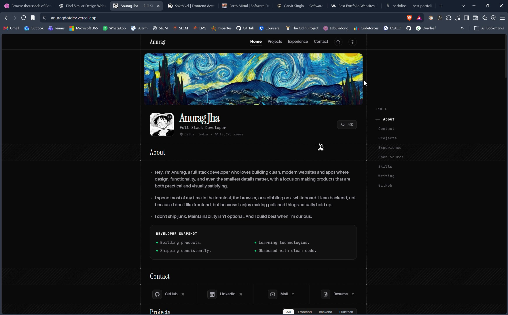
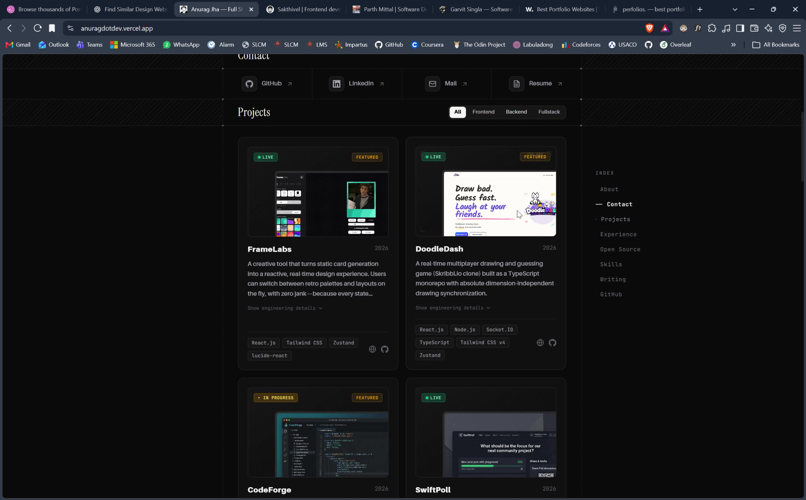
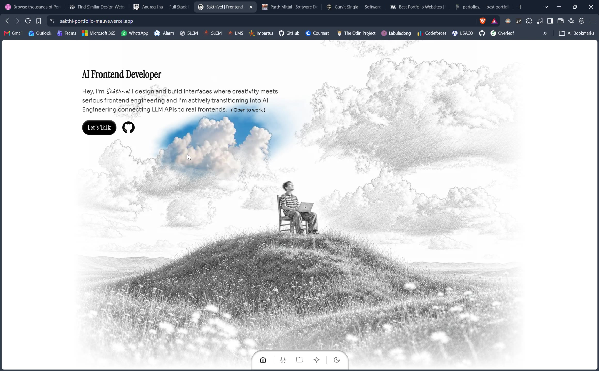
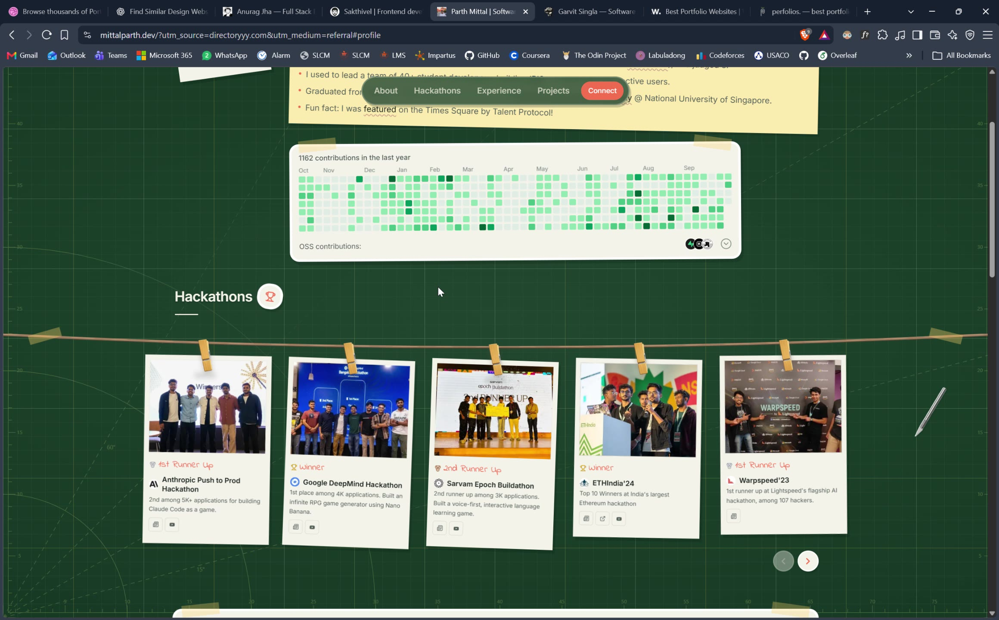
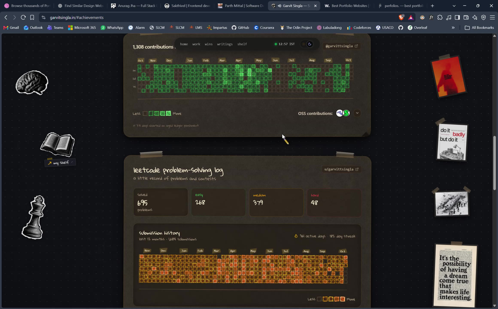

# Recording audit: components, readability and motion

This audit uses the supplied 49.052-second recording, not the current versions of the reference sites. The recording shows four portfolios.
I inspected 98 samples at two frames per second, fourteen full-resolution stills, and two denser motion sequences.
The saved stills are 2320 × 1440 pixels. Their browser chrome remains visible so the page and state can be identified.
[Capture receipt](references/video-component-audit/receipt.json) records the file hash, timing and sampling method.

The later [public source review](github-source-review.md) separates source-confirmed behavior from these recorded observations.
It covers active imports, text sizes, transitions, calendar drawing and the background mask at fixed repository commits.

## Reading the recording

| Step | Recorded range  | Surface                                                         | General health                                                                                                   |
| ---- | --------------- | --------------------------------------------------------------- | ---------------------------------------------------------------------------------------------------------------- |
| 1    | 00:00–00:17.4   | Anurag: introduction through footer                             | Strong alignment, restrained surfaces and clear component grouping. Secondary labels are faint.                  |
| 2    | 00:17.5–00:29.9 | Sakthi: day scene, cursor reveal, theme change and night scene  | Strong visual continuity. The scene attracts more attention than the small text.                                 |
| 3    | 00:30.5–00:39.9 | Parth: event wall, experience, education and projects           | Clear personal narrative and repeated paper-card treatment. Several cards compete for space.                     |
| 4    | 00:40.5–00:49.0 | Garvit: introduction, experience, activity, writing and contact | Strong grouping and consistent decorative rails. The introduction loses visibility during the recorded sequence. |

The blank states near 00:30 and 00:40 occur between site views. They do not establish an application loading defect.

## 1. Anurag: structure and reading rhythm

### Header and navigation

At 00:06, the wordmark, four navigation destinations, search icon and theme icon share one horizontal row.
The active Home link has a short underline. The icons use the same quiet circular treatment rather than competing button styles.
The header leaves the visible area during the recorded scroll. The right-side index persists independently.

The useful relationship is alignment: the header, banner, identity, section titles and body text share a consistent content rail.
Our larger header preserves that rail. Navigation text grows to 14px, icons to 16px, and controls to at least 40px.
At narrow widths, controls and navigation wrap while their text remains readable.

The recording shows search triggers, but it does not open the command palette. It cannot prove filtering, keyboard navigation or focus recovery.
Our existing palette receives its own browser checks and a larger dialog, input and results list.

### Banner, portrait and identity

The panoramic banner establishes a large visual anchor. The square portrait, serif name and compact metadata form a separate identity group below it.
The banner is considerably larger than the avatar, so the portrait does not compete with the illustration.
The name leads, followed by role, location and a view-count label.

For our layout, the existing serif identity remains the anchor. Its responsive scale grows to roughly 48–84px.
The short description grows to 16–18px. The scramble keeps each word's final width while the letters change.
This prevents the name from pushing neighboring content during the animation. The display font also receives an early preload.
Our own hero artwork remains deferred, as requested earlier.

### About and developer snapshot

The About text uses a readable line length, clear paragraph gaps and simple bullets. A bordered snapshot groups four short statements.
The snapshot does not pretend to be another major section. Its title and list remain subordinate to the main heading.
The four statements sit in two columns in the reference, which limits its height.

Our About body grows from 11px to 16px. The snapshot list uses 14px text and reserves space for its decorative icon.
On smaller screens, the columns stack. Enlarged text can wrap instead of squeezing into a fixed-height panel.

### Section boundaries and index

Thin rails and striped separator bands repeatedly mark the same content boundary. Their geometry continues across the page.
The index has one bright entry, a short marker and subdued neighboring entries. It remains in the same visual area while content moves.
At 00:08.75, Contact remains active while Projects enters the view. The recording shows that state, but not the exact selection threshold.

Our index uses current section positions and a clear marker. It appears only when the viewport has enough space for a readable rail.
Smaller layouts use a direct section selector. Section jumps preserve heading focus and follow the browser's smooth-scroll behavior.
Reduced-motion preference gives an immediate jump.

### Contact cells

GitHub, LinkedIn, mail and resume share equal-height cells, familiar icons and external-link cues.
The row gives each action equal visual weight and avoids a large contact form interrupting the reading flow.
Our contact actions use a consistent 44px minimum height, 14px labels and the same padding and hover response.

### Projects, filters and engineering details

The reference uses two columns of substantial cards. Each card repeats the same sequence: status, image, title, date, description, details and technology tags.
That repetition makes comparison easy. Images stay inside a separate frame, and the tags collect at the lower edge.
The filter group sits beside the heading. Its selected item has a filled surface rather than only a color change.
The details trigger promises deeper information without making the initial card dense. The recording does not expand it.

Our cards retain their existing original illustrations and case-study links. Titles grow to 28px, descriptions to 16px, and tags to 12px.
Filters become larger controls in their own row. The grid changes from three columns to two, then one, as space decreases.
This keeps the description readable and preserves a common card height within each row.

### Experience, freelance work and open-source rows

At [00:10.50](references/video-component-audit/03-anurag-experience.jpg), the role and dates sit at opposite ends of one row.
A short description precedes a divided metrics panel. Later freelance cards repeat the project-card language at a smaller scale.
Open-source entries use horizontal rows with repository context, a title and a short description.

The lesson is hierarchy: narrative text first, related facts together, and source actions beside the claim they explain.
Our existing experience and case studies keep their sourced facts. This pass enlarges role headings, dates and descriptions.
Our engineering notes use project periods from the resume. They do not imitate a live activity feed.

### Skills and writing

At [00:13.25](references/video-component-audit/04-anurag-stack-writing.jpg), skills use category filters followed by compact technology labels.
Writing uses a quieter list with dates, titles and summaries. The typography distinguishes those rows from application project cards.
The repeated content rail connects both sections, even though their components differ.

Our skill groups keep the same larger label scale. Writing gets a larger serif heading and 16px preview text.
The supplied article remains the single publication entry. Its unverified date and category do not become invented metadata.

### GitHub calendar, closing action and quote

At [00:15](references/video-component-audit/05-anurag-footer.jpg), the calendar, closing action, quote and small footer form distinct bands.
The calendar has a total, month labels and a less/more legend. The quote is centered and receives more empty space than the ordinary rows.
The quote fades between approximately 00:15.8 and 00:16.8 while the surrounding layout remains stable.

Our seven-row calendar stays truthful. Its labels grow, the day explorer uses larger targets, and short screens use fewer month labels.
Exact daily dates remain available through the explorer. Missing credentials still show an unavailable state.
Quotes now fade out for 180ms, change their text, then fade in for 240ms. These timings are our implementation choices.
The longest quote reserves space, so the footer does not move. Hover, focus, hidden tabs and reduced motion limit automatic playback.

[Inspect the denser quote sequence](references/video-component-audit/quote-sequence.jpg).

A small cursor character appears across Anurag's views. It adds personality, but the recording does not establish its input behavior.
This reference motif remains optional. Our handwritten notes and original project illustrations already supply a consistent personal accent.

## 2. Sakthi: scene continuity and pointer response

### Scene and readable foreground

The day scene occupies almost the full viewport. A small text block sits in the upper-left region, and a compact dock sits below the landscape.
The figure and hill create a focal point without requiring a second large card or panel.
The monochrome base and local color region share the same geometry. The reveal changes the scene's treatment rather than moving its objects.

The text remains spatially separate from most of the scenery. However, the moving blue region can approach the copy.
Our future scene needs a protected reading region and a stable fallback. The current larger foreground works independently of the pending artwork.

### Cursor reveal and fading trail

Between 00:18 and 00:22, the colored patch follows the pointer across clouds, hill and figure.
Its soft boundary and temporary persistence make the response feel less abrupt than a hard circular mask.
The stationary composition explains much of the coherence: color moves while the illustration's edges remain aligned.

The recording does not reveal the shader, brush radius, easing, decay constant or GPU cost.
The future implementation must check these with the owner's four matching images. This pass does not substitute scenery or claim a working reveal.

### Theme transition and dock

Between about 00:23.6 and 00:24.2, a dark circular region expands from the lower dock area until it covers the scene.
The next view retains the figure and hill in the same positions. The dock stays near the same lower-center anchor.
This creates continuity across a major palette change.

[Theme-wipe still](references/video-component-audit/07-sakthi-theme-wipe.jpg) · [Night scene](references/video-component-audit/08-sakthi-night.jpg) · [Denser transition sequence](references/video-component-audit/theme-sequence.jpg).

The stronger lesson is shared geometry across themes. Our light and dark themes use the same larger layout and control sizes.
The final image transition remains a separate artwork step. Keyboard use, touch behavior and reduced-motion treatment of the reference are not visible here.

## 3. Parth: physical cards within a consistent grid

### Navigation and page texture

A small rounded navigation group remains near the top while the recording moves between sections.
The graph-paper background supplies one continuous material, and the cards share an off-white surface.
Bright contact treatment provides an obvious action within that subdued navigation.
The background grid is decorative. It does not replace the alignment of the actual content.

Our surface colors, rules and local fonts provide the same continuity without changing the already selected design language.
Control height, spacing, focus and hover treatment now follow one scale throughout the page.

### Event wall and carousel

Five hanging cards use photographs, captions, result labels and small controls. Pegs, a string and mild rotations establish one repeated visual metaphor.
The photographs carry the story. Text stays inside the paper cards rather than floating over the images.
The next/previous controls are visible, but the recording does not clearly demonstrate their activation or keyboard behavior.

Our event card grows while keeping the single resume-reported result explicit. Original event photographs and official evidence remain missing.
The photography collection strip has working arrows, keyboard navigation and native scrolling. Its arrows now move only the strip, preserving the page position.

### Experience and education

[Experience and education at 00:34.50](references/video-component-audit/10-parth-experience.jpg) use one large paper panel and a vertical line with organization marks.
Roles, dates and descriptions repeat a clear row structure. Education continues the same hierarchy instead of introducing an unrelated component style.
Our experience copy now has 18px role headings, 16px descriptions and clearer dates. Narrow screens stack those records.

### Project grid and footer

[Projects at 00:35.50](references/video-component-audit/11-parth-projects.jpg) repeat image-first cards with consistent frames and metadata.
Decorative stickers stay outside the primary text. The small footer uses the same grouped icon language as the navigation.
The recording shows hover states and scrolling, but cannot prove accessible focus, image failure recovery or touch targets.
Our larger project cards, contact controls and gallery viewer receive separate browser checks.

## 4. Garvit: grouped activity and an editorial footer

### Introduction and decorative rails

At [00:41](references/video-component-audit/12-garvit-intro.jpg), the portrait and introduction share a compact central region.
A blue/yellow accent ties the name to highlighted words. Handwritten section headings and decorative objects create a consistent personal vocabulary.
The objects sit along outer rails, keeping most of the central text clear.

Between roughly 00:42.5 and 00:44, parts of the introduction lose visibility while the portrait remains.
The recording does not identify the cause. Essential portfolio copy should remain available throughout interaction.
Our name animation affects its decorative text layer while an accessible final name stays present.

### Experience and event cards

Experience entries collect their organization, role, dates and description inside one dark panel.
Event cards repeat images, titles and compact tags beneath a string of lights. The contained surfaces connect those otherwise different content types.
Our experience, event and project sections now share readable metadata, thin boundaries and consistent control feedback.

### Activity, problem-solving metrics and progress chart

The green GitHub matrix and orange problem-solving matrix use related panel shapes, totals and legends.
The lower line chart groups its data points inside the same visual family.
Different colors distinguish different datasets while the repeated geometry connects them.

Our contribution matrix and engineering notes use the same framing. This pass does not add unrelated charts or decorative tabs.
Only actual GitHub responses can populate the calendar. The engineering notes describe sourced project periods, not invented activity counts.

### Writing, quote and final contact action

At [00:47.50](references/video-component-audit/14-garvit-writing-footer.jpg), writing rows use a text-editor style, followed by a quote and contact panel.
The contact action remains clear within that larger closing card. The warm panel treatment ties the quote to the activity panels above.
Our footer grows to readable 12px labels, with larger quote text and controls. The quote transition reserves its layout space.

## What makes the references feel coherent

The main pattern is repeated geometry. Content edges, card padding, metadata positions and navigation states remain predictable while the page moves.
Each site uses a limited decorative vocabulary: guide rails, illustration, paper cards or editorial objects.
Motion usually changes one thing at a time. The surrounding composition gives the viewer a stable reference.

Our revision follows that pattern through one text scale, larger shared controls, consistent card spacing and limited motion.
The page becomes longer because ordinary copy uses 16px rather than the former 9–11px sizes.
The previous 2100px page-height budget no longer governs this revision. Readability and responsive reflow take precedence.

## Motion and evidence limits

The file reports a nominal 55fps, but its average is 27.41fps. Its median frame interval is 36.37ms and its longest interval is 60.60ms.
These are recording measurements. They do not establish the websites' actual frame rate, input latency or scroll implementation.
The recording also does not expose browser zoom, device pixel ratio, mobile behavior, keyboard recovery, reduced motion or API provenance.

Our checks examine actual font sizes, target dimensions, reflow, focus, the scramble's geometry and the quote's transition.
A smooth-looking screenshot does not prove frame pacing. This report separates visible behavior, implementation choices and behavior that still needs live assets.
